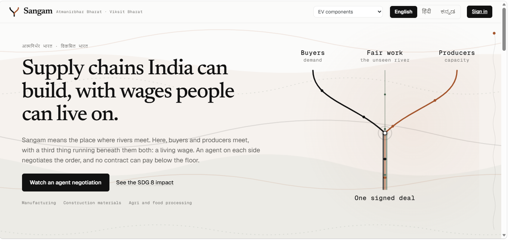
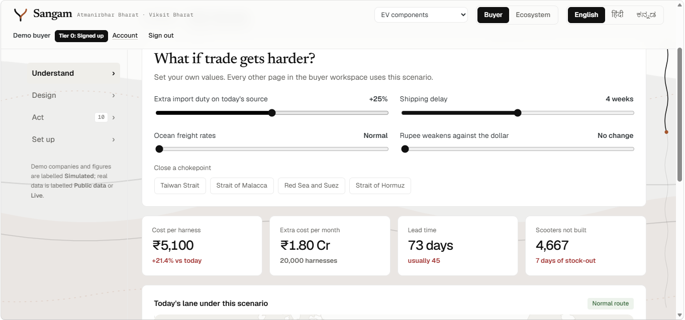
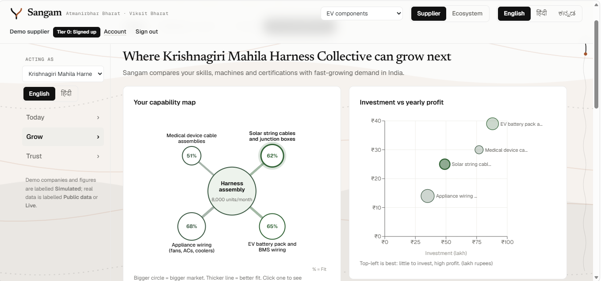
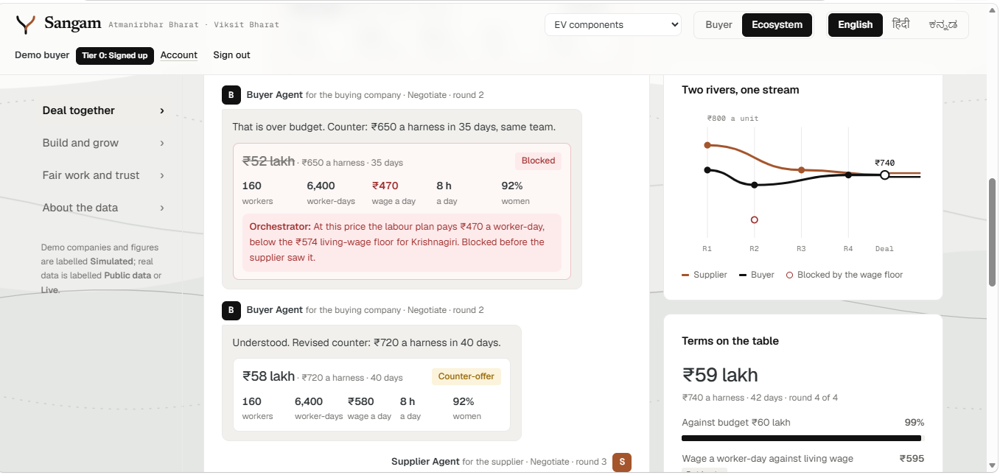

# Sangam

**Atmanirbhar Bharat · Viksit Bharat** (आत्मनिर्भर भारत · विकसित भारत)

From an import-dependent India to a self-sufficient one, with rural India growing alongside urban India.

Sangam is an AI-powered supply-chain intelligence and domestic localization platform. India is building assembly capacity fast, but the inputs underneath still come from one or two countries. Sangam doesn't just find a replacement supplier after a disruption: it designs the domestic supply chain a company will need in five years, shows MSMEs, cooperatives, FPOs and SHGs what they need to build to be part of it, and gives states and clusters a map of where the gaps are.

For HACK4SDG we added a layer on top for **UN SDG 8, decent work and economic growth**: AI agents for the buyer and each supplier negotiate the order and never go below the district's living wage, an Auditor Agent checks wages, hours and safety, and Sangam signs the skills, audits and contracts so anyone can check them.

Every number carries a tag saying where it comes from: **Live**, **Public data**, **Verified**, **Self-declared**, **Estimate** or **Simulated**.



## Run it

```bash
npm install
npm run dev
```

Open http://localhost:5173 (the web app); the API runs on port 8790. `npm test` runs the tests (157 at the time of writing) and `npm run build` type-checks and builds.

**Signing in.** Choose **Try as a buyer** or **Try as a supplier** on the landing page. With the server running this uses a one-time code (shown on screen, tagged simulated); without it, an offline demo kept in the browser tab, labelled as such. A buyer opens the Buyer and Ecosystem workspaces, a supplier the Supplier and Ecosystem ones; Sangam team accounts (set in `ECOSYSTEM_ALLOWLIST`) also get the team tools. The language buttons at the top switch English, Hindi and Kannada.

Optional settings go in `.env.local` (git-ignored; copy `.env.example`):

- **AI (agents, certificate reading, Architect suggestions):** set `LLM_API_KEY` (and `LLM_BASE_URL`, `LLM_MODEL`) to any OpenAI-compatible provider such as Gemini, Groq or OpenRouter. The key stays on the server; the browser never sees it. With no key, negotiations play back a recorded demo and the Architect works without AI suggestions.
- **Protect credential signing:** `AUTH_PROTECT_SIGNING=1` lets only Sangam team sessions sign credentials on the server.
- **Refresh the real data:** `npm run data:refresh` (UN Comtrade, World Bank, Open-Meteo, OpenStreetMap; resumes where it stopped if a service rate-limits).

## Three workspaces, three sectors

Pick a sector in the top bar: **EV components** (wiring harness), **Construction materials** (affordable housing) or **Agri and food processing** (millet mixes). Or load your own parts list.

The sidebar lists section names only. Click one for its landing page, or hover it for a quick list of its pages.

### Buyer: a company looking for supply chains

| Step | Page | What it does |
|---|---|---|
| Understand | **Supply chain today** | Parts with HS codes, India's real import value and origin countries for each (UN Comtrade 2024), concentration index, and a multi-tier diagram down to raw materials showing where India is weak below tier 1 |
| | **Simulator** | *Live world:* exchange rates, disaster alerts and shipping news turned into chokepoint risk. *What-if:* duty, delay, freight, rupee, strait closures. The what-if is a transparent formula, not AI; its port charges, duty and disruption chance are labelled estimates |
| | **Routes** | *International:* 8 sea and air routes, each as a **roadmap of legs** (supplier factory, first mile, origin port, ocean or air, transshipment, Chennai port, customs, inland truck, inspection, inventory in transit) with days (average and worst case), cost, reliability, loss rate, CO₂, documents and risks; reliability tied to each origin's World Bank LPI. *Domestic:* for every part, the named Indian supplier's production leg (price, defect rate, on-time delivery, spare capacity, trust score), then road, rail or coastal legs with terminals and documents |
| Design | **Indian options** | Three generated chains plus a **constraint optimiser** (mixed-integer program: budget, lead time, readiness, dual sourcing, import cap, rural minimum) |
| | **Future network** | Four designs generated from suppliers and possible new sites (map and network diagram), and a 5-20 year comparison of **keep importing, diversify abroad, hybrid and build in India** |
| | **Find suppliers** | Every company that can make a part, ranked by one Sangam score you can re-weight |
| | **Location planner** | Ranks 32 districts for a new unit on real climate history, OpenStreetMap infrastructure, port distance, supplier ecosystem and distance to plant; propose a unit and the network designs consider it |
| Act | **Requirements and quotes** | Publish current and future needs with firmness and confidentiality (anonymous, named, invite-only; target price and exact volume optional); a **global buyer mode** for buyers abroad (landed cost to their port); see who viewed, who is interested; compare quotes on **total cost of ownership** (price, freight, tooling, defects, trust-based risk), see each supplier's Fair Work grade, and start an agent negotiation |
| | **Fund suppliers** | Suppliers' funding requests, listed for buyers to co-fund item by item. Pledges are simulated: no money moves |
| | **Switch-over plan** | Timeline per part: close gaps, samples, qualification (PPAP), 10% pilot, 50% ramp, full switch, each with a go/no-go gate, criteria, owner and budget |
| | **Supplier development** | Co-funded upgrade projects; milestones verified by the Sangam team |
| Set up | **Company and parts** | Edit the company, parts list (or upload CSV); everything recalculates |
| | **Integrations** | Import a demand forecast (CSV); export sourcing items, awards and the network graph as CSV or JSON for any planning, procurement or graph tool |



### Supplier: a company or cooperative looking for business

| Page | What it does |
|---|---|
| **Overview** | Trust score, matching requirements, readiness checklist with cost, time and support schemes, likely consortium partners |
| **Opportunities and quotes** | Requirements they may see (confidentiality applied); express interest; submit a quote alone or as a consortium |
| **Consortia** | Invite nearby suppliers to bid together; partners accept or decline |
| **Development projects** | Start milestones and upload evidence for the Sangam team |
| **Funding** | Apply for capital item by item (R&D, machines, certificates, working capital) and track each application against buyers' pledges |
| **Future diversification** | Adjacent products with fit, investment, payback and 5/10-year return |
| **Workforce and fair work** | Skills, wages, hours and safety, filled in by voice in Hindi, Kannada or Tamil; the Fair Work grade (A to E) buyers see |
| **Sustainability** | An environmental and ethical checklist with cited sources |
| **Profile and documents** | Onboard a new company; upload a certificate (image or PDF) and have AI read its number, issuer and expiry, then plain code checks what it read |



The supplier pages are in English and Hindi; the landing page, header, sidebar and buyer pages also have Kannada.

### Ecosystem: shared by buyers and suppliers

| Page | What it does |
|---|---|
| **Agent negotiation** | Buyer, Supplier and Auditor agents bargain round by round inside hard limits (budget, living-wage floor, free capacity). Code runs the orchestration and blocks any offer below the wage floor before the supplier sees it; with no AI key it replays a recorded negotiation |
| **Reviews** | Two-way: buyers rate suppliers and suppliers rate buyers (paid on time, clear specs, fair terms, communication). Reviews cite an order and count only once the Sangam team has checked them |
| **AI Supply Chain Architect** | Design a new business and its whole supply chain from scratch: stages, suppliers and a network graph, with AI suggestions tagged as such and assumptions kept apart from data |
| **Skill clusters** | Government-listed craft and industry clusters (ODOP) with their suppliers and Fair Work grades |
| **SDG 8 impact** | Jobs, wages against the living wage, women's share, rural share of contract value, imports replaced, grievances and credentials, by district, each tagged with its source |
| **Skill Passports** | Sign a worker's skill (pseudonymous ID only) and a supplier's won contracts as tamper-proof credentials |
| **Check a credential** | Paste or open a credential to see whether it is genuine; "Change one character" shows a forgery being caught |
| **Report a problem** | Anonymous form for workers; an open report lowers the supplier's grade, and reports of child or forced labour go straight to the desk |
| **Data sources** | Every source, its licence, date and what it powers |

Visible to Sangam team accounts only: the **Verification desk** (decide on Auditor flags, resolve grievances, check identity, capacity and certificates of new companies, match reviews to orders, verify development milestones) and the **District dashboard** (unmet demand against local capability within 300 km, with real climate and connectivity; CSV export).



## Signed credentials

`src/ecosystem/vc.ts` signs and checks credentials shaped like a [W3C Verifiable Credential](https://www.w3.org/TR/vc-data-model-2.0/), with Ed25519 (ECDSA P-256 on browsers without it) through Web Crypto, so the same code runs on the server and in the browser. The server's key (`server/credentials.ts`) is created on first run in `.sangam-issuer.local`, which git ignores. Until the shared server is running, the app signs with a demo key kept in the browser, and says so. With `AUTH_PROTECT_SIGNING=1`, server signing is limited to Sangam team sessions.

## Trust score

0-100, explainable: identity checked (15), certificates checked (20), profile completeness (15), **verified reviews** (35, with a Bayesian average so one review can't dominate) and order history (15). Reviews must cite a purchase order and attach evidence; they count only after verification.

## Where the data comes from

| | Source | Used for |
|---|---|---|
| Public data | [UN Comtrade](https://comtradeplus.un.org) (public API), India imports by HS code and partner, 2024 | Real import picture for every part and upstream input |
| | [World Bank LPI](https://lpi.worldbank.org) | Port and schedule reliability per origin country |
| | [Open-Meteo](https://open-meteo.com) historical weather 2015-2024 | District heavy-rain and heat exposure |
| | [OpenStreetMap](https://www.openstreetmap.org/copyright) via Overpass | District rail, airport, highway and industrial-land counts |
| | [DataMeet](https://github.com/datameet/maps) (CC BY 4.0), [Natural Earth](https://www.naturalearthdata.com) | Map outlines; India shown with its official boundary |
| Live | Frankfurter (ECB), GDACS / NASA EONET / USGS, GDELT | Exchange rates, disaster alerts, shipping news |
| Estimate | Sangam models | Grid reliability by state, transport rates, port charges, duty, long-term cost growth |
| Simulated | Demo data | Buyer companies, suppliers and their performance, new-site costs, market sizes |

`src/real/*.json` holds the fetched data with source and date, so the app works offline and the numbers are reproducible.

## How the numbers are made

Everything numeric comes from deterministic code. AI is used only to read documents, write agent messages and suggest Architect options, and code checks the numbers it produces.

| File | What it does |
|---|---|
| `src/engine.ts` | Matching, gaps, consortia, chain scoring |
| `src/routes.ts`, `src/chainRoute.ts` | Route legs and landed cost, international and domestic |
| `src/optimise.ts` | Mixed-integer sourcing optimiser (javascript-lp-solver) |
| `src/network.ts` | Generated network designs, hybrid strategy, long-horizon cost and returns |
| `src/tco.ts`, `src/trust.ts` | Quote total cost of ownership; trust score |
| `src/realdata.ts` | District scores from the real data |
| `src/sectors/*.ts` | Sector templates (EV, construction, agri) |
| `src/sim.ts`, `src/scenario.ts` | What-if simulator (cost, lead time, stock-out, expected loss) |
| `server/agents/*` | Buyer, Supplier and Auditor agents and the orchestrator that enforces the limits |
| `server/llm.ts`, `server/certificates.ts` | Provider-neutral LLM client; certificate reading with code checks |
| `src/architect/*`, `server/architect.ts` | AI Supply Chain Architect |
| `server/auth.ts`, `src/access/*` | One-time-code sign-in, roles and the demo accounts |
| `src/nav/*` | Sidebar sections, landing pages and hover lists |
| `scripts/fetch-real-data.mjs` | Downloads the public datasets |

## Path to production

| Today | Next step |
|---|---|
| SQLite in a Node server | Postgres, with pgvector for matching |
| Agents on any OpenAI-compatible LLM with a deterministic orchestrator | LangGraph or the Claude Agent SDK if the flow grows branches |
| Beckn-shaped agent messages | A Beckn gateway on the ONDC network |
| Credentials checked in the app | A DID-based issuer and DigiLocker or a wallet app |
| Browser speech recognition | Bhashini for speech, translation and text-to-speech |
| In-memory supply network graph | Neo4j once there are thousands of suppliers |

This is the HACK4SDG build. The earlier SAP Hackfest prototype it grew from is kept at the git tag `sap-hackfest-v1`.
