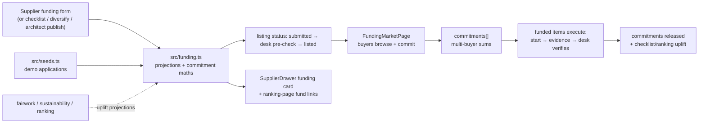

# Plan: the funding bridge — suppliers apply, buyers co-fund

**Goal:** a supplier can **apply for funding** on our portal — for sustainable-technology R&D, manufacturing machines, certifications, or working capital for a green upgrade. The application becomes a **listing in a buyer-side marketplace** ("Fund suppliers"): buyers browse it, **commit money to specific items** (multi-buyer, simulated), and track the funded work through the same milestone → evidence → verification lifecycle the platform already has. Buyers do this to meet their **sustainability goals and supply requirements**; suppliers get capital they cannot raise alone. Every rupee on screen is **simulated or estimated** and tagged — no real payments, no invented scheme figures.

**One-line story for the demo:** *a Gold-level rural collective needs ₹9 lakh for a testing R&D rig and a solar upgrade; two buyers commit ₹6 lakh of it on the marketplace; the rig ships, evidence is verified, the collective's sustainability level and Sangam score rise — the buyer's green goals are met with receipts.*

---

## 1. What exists today, and why it's a good base

| Already in the repo | How the plan uses it |
|---|---|
| `DevProject` + `Milestone` (`src/model.ts`): status ladder todo → doing → submitted → verified, evidence file names, Verification desk queue | **The funded-work lifecycle**: a funded application's items execute exactly like dev-project milestones (supplier starts, uploads evidence, desk verifies) — reuse, don't reinvent |
| `diversify.ts` `evaluateOpportunity()` → `OppResult` (investment breakdown equipment/certification/training/working-capital, revenue/profit, **paybackYears**, roi5/roi10, 10-yr cumulative cash) | **The financial projection template** for applications: the same shape of math computes an application's payback and uplift, tagged estimated |
| `sustainability.ts`: `CHECKLIST` items (each with weight, `schemes` hints), `nextSteps()` ranked by points-gained, `scoreSustainability()` | **The "why fund this" join**: a funding item can link to a checklist item (`sustainabilityItemId`); funding it produces an expected **level/score uplift** the buyer can see before committing |
| `ranking.ts`: fixed-scale metric contributions with provenance | **"Sangam score after funding"** projection per application, shown on the marketplace card |
| `trust.ts` `trustScore`, `creditBand` on seller details | Buyer-side assurance signals on every listing card |
| Architect module (`src/architect/`): greenfield business plans with `budgetGapLakh` + PMEGP/CGTMSE scheme lists | **A publish source**: an aspiring supplier can turn an Architect plan's gap into a funding application (Phase 5) |
| Scheme hints as static strings (`CGTMSE credit guarantee`, `PMEGP`, SIDBI energy-efficiency finance, ZED subsidy) in `engine.ts`, `sustainability.ts`, `certInfo` | **Scheme stacking display** on items — names only, always pointing at `sustainability-refs.json`; never new invented figures |
| Server doc-store pattern: `TABLES` + `db.put/get/list`, routes mirroring workforce/sustainability; contracts `ROUTES` | **Persistence**: a `funding` table + `/api/funding` routes, additive and flagged to P1 |
| Verification desk "Sustainability evidence" queue pattern (load → flip evidence → persist) | **The pre-check and release flow**: desk verifies application evidence and milestone evidence; verified milestones **release** buyer commitments |

**The gap today:** suppliers cannot *ask* for capital. Development projects exist but are **buyer-initiated** (from StepChains/NetworkPage, `buyerSharePct` hardcoded 50 and display-only), the Architect computes a budget gap but publishes nothing, and there is no buyer surface for "who needs funding and what do I get for it".

---

## 2. The model

### 2.1 FundingApplication (stored per supplier; marketplace lists all `listed`+)

```ts
export type FundingKind = 'machine' | 'green-tech' | 'rnd' | 'certification' | 'working-capital';

export interface FundingItem {
  id: string;
  kind: FundingKind;
  label: string;                       // e.g. 'Rooftop solar 15 kW + net meter'
  labelHi: string;
  costLakh: number;
  months: number;                      // execution time once funded
  purpose: string;                     // why this item, one line
  schemes?: string[];                  // names only; see sustainability-refs.json
  sustainabilityItemId?: string;       // CHECKLIST id this item serves → level uplift
  status: 'todo' | 'doing' | 'submitted' | 'verified';   // mirrors Milestone once funded
  evidence?: string; updatedAt?: string;
}

export interface FundingCommitment {
  buyerId: string; buyerName: string;
  itemIds: string[];                   // which items this buyer backs
  amountLakh: number;                  // ≤ sum of the items' costs (validated)
  committedAt: string;
  status: 'pledged' | 'released';      // released when the backed items verify
}

export interface FundingApplication {
  id: string;                          // 'fund-<sector>-<n>'
  sector: SectorId; sellerId: string; sellerName: string;
  title: string;                       // 'Solar rig + testing R&D for harness grade-up'
  purpose: string;                     // 2-3 sentence narrative
  items: FundingItem[];
  evidence: string[];                  // supporting documents (names only)
  status: 'draft' | 'submitted' | 'listed' | 'funded' | 'completed';
  commitments: FundingCommitment[];
  projections: FundingProjections;     // computed, tagged estimated — never hand-typed
  createdAt: string; updatedAt: string;
}

export interface FundingProjections {
  totalAskLakh: number;
  paybackMonths: number | null;        // total cost ÷ projected monthly profit uplift
  roi5yrPct: number | null;
  capacityUpliftPct: number | null;    // machines / green-tech
  qualityUpliftPct: number | null;     // R&D / testing items
  sustainabilityUplift: { from: SustainabilityLevel; to: SustainabilityLevel; points: number } | null;
  sangamScoreUplift: number | null;    // expected ranking gain, same fixed-scale maths as ranking.ts
  source: 'estimated';
}
```

### 2.2 Score, levels and precedence (one `FUNDING_RULES` table, tagged estimated)

- **Completeness gate**: an application must have ≥1 item, a purpose ≥40 chars, and ≥1 evidence document to be `submitted`; the desk pre-checks it before `listed` (a thin or copy-paste application is returned to draft with a note — mirrors the desk's reject pattern).
- **Commitment arithmetic** (unit-tested): `committedLakh = Σ commitments.amountLakh`; `remainingLakh = totalAskLakh − committedLakh` (never below 0 — a commit larger than the remainder is rejected in the UI and the model); an application flips `funded` when `remainingLakh === 0` and every item has ≥1 commitment behind it.
- **Release rule**: when a backed item's milestone reaches `verified` (desk-checked evidence), the commitments behind it flip `released` — buyer portfolios show released money as "impact delivered".
- **Level uplift** (`sustainabilityUplift`): computed by re-scoring with the funded items' linked CHECKLIST answers forced to their best plausible value — shown as "expected", never as a promise; the actual level still changes only through real checklist taps.
- **No repayment tracking** (product decision): this is milestone co-funding, not loans — the buyer's return is the supplier relationship and the sustainability outcome.

### 2.3 Money tags

`projections.source = 'estimated'` always; commitments carry the buyer's name and are `simulated` on demo data; scheme names come from `sustainability-refs.json` only. The marketplace header states: *"Commitments on Sangam are simulated pledges for the prototype — no money moves."*

---

## 3. Supplier side: apply and track

**Sources of an application** (all converge on the same form state):
1. **Manual** — Supplier → Grow → **Funding** → "Start an application": add items (kind, label, cost, months, purpose, scheme hints auto-suggested by kind: machine → CGTMSE/PMEGP, green-tech → SIDBI energy-efficiency finance, certification → ZED subsidy), attach evidence names, save draft, submit.
2. **From the Sustainability checklist** — each `nextSteps()` row gains "Fund this": pre-fills one item (label, linked `sustainabilityItemId`, kind inferred: energy-renewable → green-tech, cert items → certification).
3. **From Diversification** (Phase 5) — an evaluated opportunity's investment block becomes a machine/working-capital application.
4. **From the Architect** (Phase 5) — a business plan's `budgetGapLakh` publishes as a working-capital + machine application.

**The page** (Supplier → Grow → Funding, mirroring the Sustainability page's phone-first pattern): applications as cards (status chip, committed progress bar per item, remaining ask), the form for draft editing, live projections preview (payback + uplift update as items change), submit → desk, and a funded-work tracker (start / upload evidence per item, identical to DevelopmentPage's flow).

---

## 4. Buyer side: the marketplace

**Buyer → Act → Fund suppliers** (`FundingMarketPage`):
- **Filters**: sector, part (lineId), funding kind, minimum sustainability level, district, goal chips (renewables / recycling / water / local sourcing — derived from linked CHECKLIST pillar).
- **Listing cards** (`FundingCard`, also embedded in SupplierDrawer and linked from ranking rows of suppliers whose applications exist): seller + trust band + badges, title/purpose, itemised ask with per-item committed progress, projections (payback, uplift, "Sangam score after funding"), provenance tags everywhere.
- **Commitment flow**: pick items → amount slider/input bounded by the remaining ask → confirm ("Commit ₹3 L — simulated"). Multi-buyer sums live; the card shows "₹6 L of ₹9 L committed by 2 buyers".
- **My commitments** tab on the same page: pledged vs released, per application progress, links to the supplier's milestone evidence.
- **Ranking-page link**: a seller with a listed application shows "Needs ₹X for <first item> — fund it" under their row expansion.

**Demo moment (about 60 s):** the collective's solar+R&D application is listed at ₹9 L with ₹3 L pledged; the buyer opens Fund suppliers, filters goal=renewables, commits ₹3 L more (now funded); supplier starts the rig item and uploads evidence; desk verifies → commitment releases; the checklist's solar item ticks Yes → level badge and the Find-suppliers ranking move in the same demo.

---

## 5. Data flow



---

## 6. Files

### New
| File | Purpose |
|---|---|
| `src/funding.ts` | Types, `FUNDING_RULES`, `projectOutcomes()`, `commitTotal()/remainingAsk()/applyCommitment/releaseForVerified()`, `fundingUplift()`, status ladder — with tests |
| `tests/funding.test.ts` | Commitment sums, over-commit rejection, funded-flip, release rule, projection sanity, uplift join |
| `src/seller/FundingPage.tsx` | Applications list + form + funded-work tracker |
| `src/seller/funding.ts` | Persistence: server → localStorage → seeds (same three-layer pattern as workforce/sustainability) |
| `src/buyer/FundingMarketPage.tsx` | Marketplace + My commitments tab |
| `src/components/FundingCard.tsx` | The shared listing card (marketplace, drawer, ranking link) |

### Changed (all additive; each flagged to its owner in the commit)
| File | Change |
|---|---|
| `src/seeds.ts` | `seedFundingApplications()`: 4 demo applications across kinds/levels, one with an existing commitment from the demo buyer |
| `src/App.tsx` | Nav: Buyer → Act → **Fund suppliers**; Supplier → Grow → **Funding** |
| `src/components/SupplierDrawer.tsx` | Funding card (applications + commitments) |
| `src/buyer/RankingPage.tsx` | "Needs ₹X — fund it" row-expansion link |
| `src/contracts.ts` + `server/db.ts` + `server/app.ts` | `FundingApplication` type, `funding` table, `GET /api/funding`, `GET/PUT /api/funding/:id` |
| `src/ecosystem/VerificationDesk.tsx` | Funding applications pre-check queue + funded-item evidence queue (releases commitments) |
| `src/seller/SustainabilityPage.tsx` | "Fund this" on next-steps rows |

---

## 7. Phases

| Phase | Work | Done when |
|---|---|---|
| **1** | `funding.ts` core + projections + tests | Commitment sums, over-commit rejection, funded-flip, release rule, projection and uplift maths all unit-tested |
| **2** | Supplier page + persistence + seeds | Creating, itemising, submitting, and tracking an application works; demo applications appear from seeds |
| **3** | `ranking.ts`-style marketplace page + FundingCard + drawer card + ranking link | The §4 demo moment's buyer half works in the browser |
| **4** | Server route + contracts + desk queues (pre-check, evidence release) | The full §4 demo moment works end-to-end: publish → commit → execute → verify → release → uplift visible |
| **5** *(optional)* | Diversification/Architect publish sources, Buyer-agent funding suggestions, Impact-page "green capacity added" tiles (SDG 9/13), README/deck | — |

## 8. Verification

- `npm test`: commitment arithmetic (sums, remainder bounding, funded-flip), release-on-verify, projections sane (payback ≥ 0, uplifts bounded), uplift join matches a re-scored checklist.
- `npm run build`.
- Browser walkthrough of the §4 demo moment with screenshots.

## 9. Warnings

> [!WARNING] **All money is simulated.** The marketplace header and every application carry the simulation tag; no payment, escrow or loan language anywhere.
> [!IMPORTANT] **Scheme names are display-only** and must resolve to `src/real/sustainability-refs.json` entries — no new scheme figures or URLs invented.
> [!NOTE] `contracts.ts`, `server/*`, `VerificationDesk.tsx`, `App.tsx` are teammates' files — additive edits only, flagged in commit messages per team convention.

## 10. Open questions (defaults in **bold**)

1. Can one application have **multiple buyers on the same item**? → **Yes**; amounts per commitment, item shows total covered.
2. Can a buyer commit to a **partially unfunded application** and leave the rest open? → **Yes** — that's the marketplace's point; applications show remaining ask until funded.
3. What stops a **fake application**? → Desk pre-check before `listed` + evidence requirements; same trust model as the rest of the platform.
4. Should commitments **expire** if milestones stall? → **No** for the prototype; a "stalled" flag is Phase 5 at the earliest.
